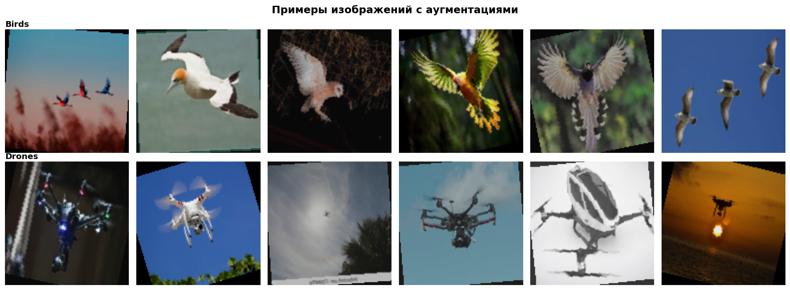
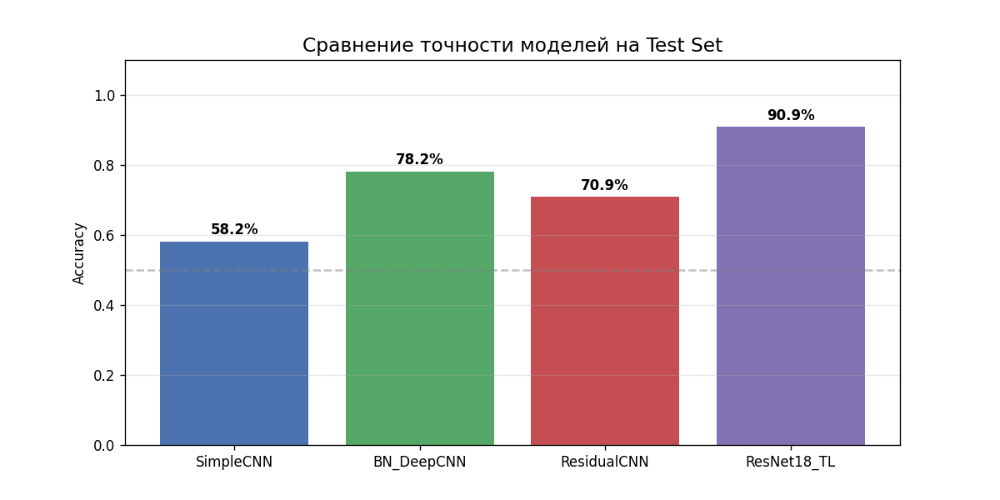
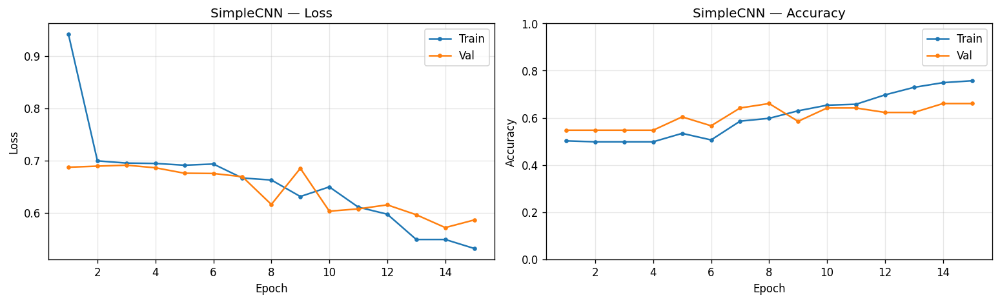
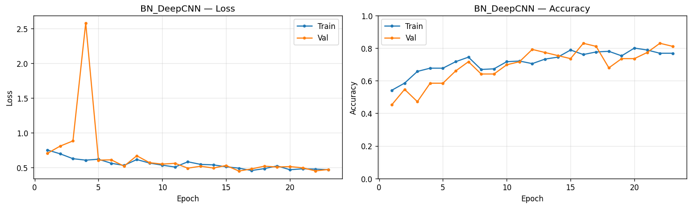
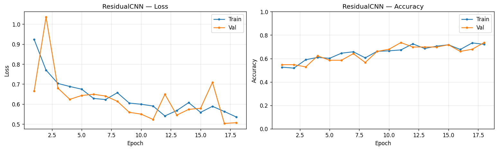
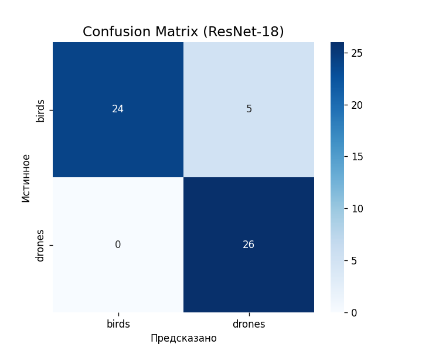

# Birds vs Drones: классификация изображений свёрточными нейросетями

Бинарная классификация изображений **птица / дрон** на небольшом самостоятельно собранном датасете. В проекте сравниваются три CNN-архитектуры, написанные с нуля, и трансферное обучение на предобученной ResNet-18.

Работа выполнена в рамках лабораторной работы по дисциплине «Основы нейронных сетей» (СПбГЭТУ «ЛЭТИ»).

**Лучший результат: 90,91% точности на тесте** (ResNet-18 с трансферным обучением) против 58–78% у сетей, обученных с нуля.

## Задача

Птица и дрон на фотографии часто выглядят похоже: небольшой тёмный силуэт на фоне неба. Нужно научить модель различать их, имея всего несколько сотен изображений. Основной вопрос проекта: **что даёт больше при малом объёме данных: своя архитектура или предобученная модель?**

## Данные

Датасет собран из трёх источников:

- часть изображений взята из датасета на Kaggle: [drone-bird-classification](https://www.kaggle.com/datasets/imbikramsaha/drone-bird-classification/data);
- часть скачана по разным поисковым запросам Google (`bird flying sky`, `drone flying sky`, `quadcopter drone air` и др.), см. `imagescraping.ipynb`;
- небольшое число изображений добавлено вручную.

Сам датасет в репозиторий не включён: в нём много файлов.

| Параметр | Значение |
|---|---|
| Классы | `birds` / `drones` (179 / 180 изображений, баланс сохранён) |
| Всего | 359 изображений |
| Train / Val / Test | 251 (70%) / 53 (15%) / 55 (15%) |
| Размер входа | 128 × 128, нормализация по статистике ImageNet |

Разбиение выполняется в коде случайно с фиксированным seed (`random_split`, seed = 42), поэтому оно воспроизводимо. На тесте оказалось 29 птиц и 26 дронов.

Датасет небольшой, и это осознанное ограничение эксперимента: он хорошо показывает, как архитектура и стратегия обучения влияют на качество, когда данных мало.



### Аугментация (только для обучающей выборки)

- горизонтальное отражение (p = 0.5) и вертикальное (p = 0.1);
- поворот до 20°;
- `ColorJitter` (яркость, контраст, насыщенность: 0.3, оттенок: 0.05);
- перевод в оттенки серого (p = 0.05).

## Модели

| Модель | Устройство | Параметров |
|---|---|---|
| **SimpleCNN** | Базовая линия: 3 блока Conv → ReLU → MaxPool (32→64→128), классификатор 32768→256→2 с Dropout 0.5, без BatchNorm | 8 482 626 |
| **BN_DeepCNN** | 4 блока по две свёртки (32→64→128→256) с BatchNorm, Dropout2d в первых блоках, AdaptiveAvgPool(4), классификатор 4096→1024→256→2 с BatchNorm и Dropout | 5 634 978 |
| **ResidualCNN** | Свёртка 7×7 + MaxPool, три residual-блока (64→128→256) со skip-connections, Global Average Pooling, Dropout 0.4 | 1 233 218 |
| **ResNet-18 (TL)** | Предобучена на ImageNet, последний слой заменён на `Dropout(0.4) + Linear(512 → 2)` | 11 177 538 |

**Трансферное обучение ResNet-18 в два этапа:**

1. *Feature extraction*: заморожены все слои, кроме нового классификатора (обучаемых параметров: 1 026), LR = 1e-3, 10 эпох. Лучшая точность на валидации: 94,34%.
2. *Fine-tuning*: размораживаются все слои, LR = 1e-4, weight decay = 1e-4, early stopping. Лучшая точность на валидации: 98,11%.

## Обучение

- Фреймворк: PyTorch, обучение на GPU (NVIDIA GeForce RTX 3050, 8 ГБ)
- Функция потерь: `CrossEntropyLoss`
- Оптимизатор: Adam, weight decay = 1e-4
- Learning rate: 1e-3 для моделей с нуля и первого этапа ResNet-18, 1e-4 для fine-tuning; планировщик `StepLR` (шаг 10 эпох, множитель 0.5)
- Размер батча: 32
- Не более 30 эпох; early stopping по `val_accuracy` (patience 7, на первом этапе ResNet-18: 5), сохраняются лучшие веса
- Воспроизводимость: `set_seed(42)`, `cudnn.deterministic = True`

## Результаты

| Модель | Параметры | Best Val Acc | Test Acc | Ошибок на тесте (из 55) |
|---|---|---|---|---|
| SimpleCNN | 8,5 млн | 66,04% | 58,18% | 23 |
| BN_DeepCNN | 5,6 млн | 83,02% | 78,18% | 12 |
| ResidualCNN | 1,2 млн | 73,58% | 70,91% | 16 |
| **ResNet-18 (TL)** | 11,2 млн | **98,11%** | **90,91%** | **5** |



### Кривые обучения

| SimpleCNN | BN_DeepCNN |
|---|---|
|  |  |

| ResidualCNN | ResNet-18 (transfer learning) |
|---|---|
|  |  |

### Матрица ошибок лучшей модели



| Класс | Precision | Recall | F1 | Примеров |
|---|---|---|---|---|
| birds | 1.00 | 0.83 | 0.91 | 29 |
| drones | 0.84 | 1.00 | 0.91 | 26 |

Модель не пропускает дронов (recall = 1.00), но 5 фотографий птиц приняла за дронов. Вероятная причина: на дальних ракурсах птица выглядит как небольшой тёмный объект на фоне неба, то есть почти как дрон.

## Выводы

- **Трансферное обучение сильнее всего при малом объёме данных.** ResNet-18 обошла лучшую «домашнюю» модель на 12,7 п.п. (90,91% против 78,18%).
- **Архитектура важнее числа параметров.** ResidualCNN с 1,2 млн параметров обошла SimpleCNN с 8,5 млн: в SimpleCNN почти все параметры сидят в одном полносвязном слое, а skip-connections и Global Average Pooling позволяют обойтись без него.
- **BN_DeepCNN показала лучший результат среди сетей, обученных с нуля**, при меньшем числе параметров, чем у SimpleCNN. Её преимущество складывается из нескольких факторов: BatchNorm, большая глубина и другой классификатор.
- **Регуляризация нужна на малых выборках.** Аугментация, Dropout, weight decay и early stopping применялись во всех экспериментах.

## Ограничения

- Тестовая выборка маленькая (55 изображений): одна ошибка меняет точность примерно на 1,8 п.п., поэтому небольшие различия между моделями статистически ненадёжны.
- Модели отличаются сразу несколькими параметрами (глубина, нормализация, классификатор), поэтому нельзя приписать выигрыш одному конкретному приёму: контролируемых абляций в проекте нет.
- Early stopping и выбор лучших весов делались по валидационной выборке (53 изображения), поэтому `Best Val Acc` слегка оптимистична. Честная оценка качества: `Test Acc`.
- Разрыв между своими сетями и ResNet-18 почти наверняка сократился бы на более крупном датасете.

## Структура репозитория

```
.
├── CNN1.ipynb              # данные, архитектуры, обучение, оценка, анализ ошибок
├── imagescraping.ipynb     # скачивание изображений по поисковым запросам
├── dataset_samples.png     # примеры из датасета
├── history_*.png           # кривые обучения моделей
├── models_comparison.png   # сравнение точности на тесте
└── confusion_matrix.png    # матрица ошибок ResNet-18
```

Ноутбук также сохраняет обученные веса моделей в файлы `*.pth`.

## Как запустить

1. Установите зависимости:
   ```bash
   pip install torch torchvision numpy pandas matplotlib seaborn scikit-learn jupyter
   ```
2. Подготовьте датасет: создайте папку `dataset/` рядом с ноутбуком, внутри две папки с классами: `dataset/birds/` и `dataset/drones/`. Положите туда изображения, например из [Kaggle-датасета](https://www.kaggle.com/datasets/imbikramsaha/drone-bird-classification/data) и собранные самостоятельно. Разбиение на train / val / test ноутбук делает сам.
3. Откройте `CNN1.ipynb` и запустите ячейки по порядку. Обучение на GPU заметно быстрее, но модели небольшие и запускаются и на CPU.

## Стек

Python · PyTorch · torchvision · NumPy · pandas · Matplotlib · seaborn · scikit-learn · Jupyter
